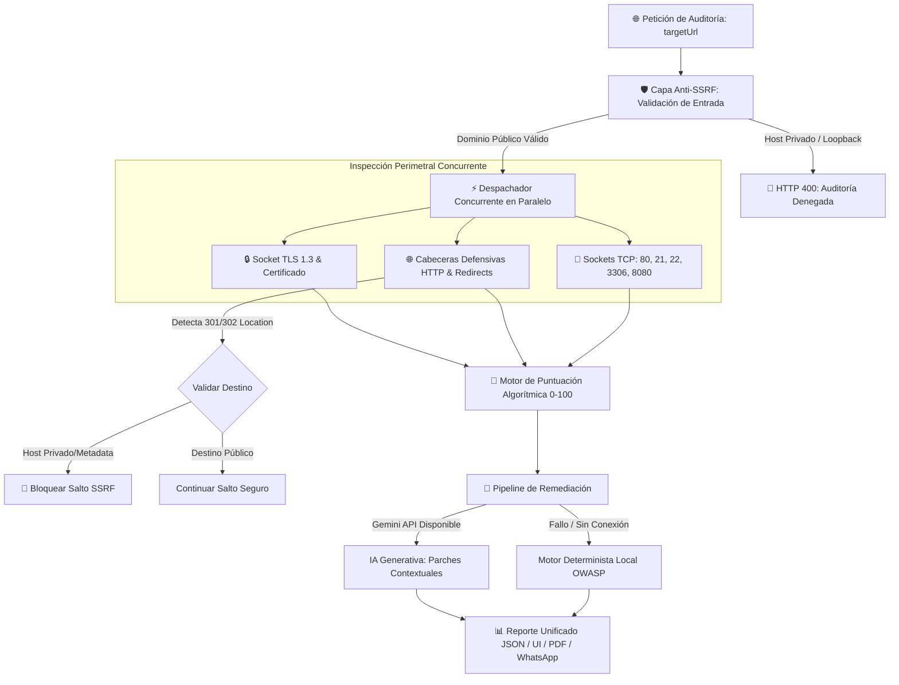

<div align="center">

# 🛡️ DEFENSA TI

### *Ultra-Fast Perimeter Security, TLS Hardening & OWASP Compliance Engine*

<p align="center">
  Un motor de auditoría perimetral no intrusivo y de alta velocidad diseñado para evaluar la postura criptográfica, exposición de sockets TCP y directivas defensivas OWASP en cualquier infraestructura web moderna.
</p>

[](https://github.com/martincastillo1996/defensati/actions)
[](https://nextjs.org/)
[](https://www.typescriptlang.org/)
[](#-arquitectura-de-seguridad-anti-ssrf)
[](LICENSE)

[🌐 Probar en Producción](https://defensati.vercel.app) &bull; [📖 Documentación](#-características-principales) &bull; [⚡ API Quickstart](#-api-quickstart-curl) &bull; [💬 Contacto Comercial](https://wa.me/17856433991)

---

</div>

## 📑 Tabla de Contenidos

- [🎯 Por qué DEFENSA TI](#-por-qué-defensa-ti)
- [✨ Características Principales](#-características-principales)
- [📊 Tabla Comparativa](#-tabla-comparativa)
- [🏛️ Arquitectura del Sistema](#-arquitectura-del-sistema)
- [🛡️ Blindaje Anti-SSRF y Validación de Redirecciones](#-blindaje-anti-ssrf-y-validación-de-redirecciones)
- [🚀 Inicio Rápido (Local)](#-inicio-rápido-local)
- [⚡ API Quickstart (cURL)](#-api-quickstart-curl)
- [🧪 Suite de Tests Automatizados](#-suite-de-tests-automatizados)
- [💼 Conversión Comercial & WhatsApp](#-conversión-comercial--contacto)
- [📄 Licencia](#-licencia)

---

## 🎯 Por qué DEFENSA TI

La mayoría de escáneres de seguridad tradicionales (*Qualys*, *Mozilla Observatory*) sufren de tres problemas críticos:
1. **Lentitud extrema:** Tardan entre 30 y 120 segundos en auditar un solo dominio.
2. **Cero contexto de negocio:** Arrojan términos técnicos densos que ningún dueño de empresa o tomador de decisiones entiende.
3. **Falta de parches accionables:** Indican qué está mal, pero no entregan la configuración exacta para solucionarlo.

**DEFENSA TI** resuelve esto ejecutando una **auditoría completa en menos de 1.2 segundos**, traduciendo cada fallo a impacto financiero/comercial y generando parches listos para copiar y pegar en **Nginx, Apache y Express**.

---

## ✨ Características Principales

* ⚡ **Auditoría Perimetral Ultrarrápida (< 1.2s):** Inspección asíncrona concurrente de transporte TLS, puertos TCP y cabeceras HTTP sin colgar el hilo de ejecución.
* 🔒 **Inspección de Sockets TLS a Nivel Kernel:** Conexión cruda mediante `node:tls` para verificar algoritmos de cifrado, cadenas de certificación, vigencia y compatibilidad con **TLSv1.3**.
* 🔌 **Zero-Downtime TCP Sockets:** Sondeo perimetral pasivo en puertos críticos (`80`, `21 FTP`, `22 SSH`, `3306 MySQL`, `8080 Proxy`) con timeouts de `600ms`.
* 🛡️ **Hardening Anti-SSRF Estricto:** Mitigación en dos capas (DNS pre-resolución e inspección de cabeceras `Location` en saltos 301/302) contra subredes privadas RFC 1918 y metadatos de AWS/Cloud.
* 🤖 **Motor de Remediación con Cascada Dual:** Inteligencia artificial vía Google Gemini con fallback inmediato a reglas heurísticas estáticas ($0 costo permanente).
* 📄 **Dictamen Forense en PDF A4:** Generación instantánea de reportes ejecutivos listos para presentar ante auditorías de cumplimiento (ISO 27001 / PCI-DSS).
* 💼 **Modo Dual Dueño de Negocio vs. Ingeniero:** Interruptor en vivo que traduce las directivas técnicas a riesgos de clonación de marca, pérdida de ventas o robo de tarjetas.

---

## 📊 Tabla Comparativa

| Capacidad / Métrica | **DEFENSA TI** | Mozilla Observatory | Qualys SSL Labs |
| :--- | :---: | :---: | :---: |
| **Tiempo de Auditoría Promedio** | **⚡ < 1.2 seg** | 🐢 15 - 30 seg | ⏳ 60 - 120 seg |
| **Inspección de Sockets TCP (21, 22, 3306)** | ✅ **Sí (Nativa)** | ❌ No | ❌ No |
| **Generación de Parches Nginx/Apache/Node** | ✅ **Inmediata (IA + Local)** | ❌ Solo enlaces | ❌ No |
| **Protección Activa Anti-SSRF (RFC 1918)** | ✅ **DNS + Redirects** | ❌ N/A | ❌ N/A |
| **Persistencia de Enlaces $0 (Sin Base de Datos)** | ✅ **Payload Autónomo** | ❌ Requiere BD | ❌ Temporal |
| **Exportación Forense A4 PDF** | ✅ **Nativa en 1-Click** | ❌ No | ❌ Solo Print |
| **Traducción a Impacto de Negocio** | ✅ **Sí (Modo Dual)** | ❌ Solo técnico | ❌ Solo técnico |

---

## 🏛️ Arquitectura del Sistema



---

## 🛡️ Blindaje Anti-SSRF y Validación de Redirecciones

Para evitar que el servidor sea utilizado como vector de ataque contra redes internas (*Server-Side Request Forgery*):

1. **Resolución DNS Asíncrona:** Se resuelve el hostname con `dns.resolve4` antes de abrir cualquier socket. Si resuelve hacia `127.0.0.0/8`, `10.0.0.0/8`, `172.16.0.0/12`, `192.168.0.0/16` o `169.254.169.254`, la petición se rechaza de inmediato.
2. **Inspección de Saltos HTTP (`Location`):** Si un dominio público intenta desviar la auditoría hacia una IP interna mediante un código `301`, `302`, `307` o `308`, el validador intercepta la cabecera `Location` y neutraliza el salto antes de realizar la segunda petición.

---

## 🚀 Inicio Rápido (Local)

### Prerrequisitos
* Node.js v20.x o superior
* npm v10.x o superior

```bash
# 1. Clonar el repositorio
git clone https://github.com/martincastillo1996/defensati.git
cd defensati

# 2. Instalar dependencias
npm install

# 3. Configurar variables de entorno (Opcional para IA)
cp .env.example .env.local
# Agrega tu GEMINI_API_KEY si deseas remediación por IA generativa

# 4. Iniciar en modo desarrollo
npm run dev
```

Abre en tu navegador [http://localhost:3000](http://localhost:3000).

---

## ⚡ API Quickstart (cURL)

Puedes consumir el motor de auditoría perimetral de forma programática:

```bash
curl -X POST https://defensati.vercel.app/api/scan \
  -H "Content-Type: application/json" \
  -d '{"url": "https://autonoma.pe"}'
```

### Respuesta de Ejemplo (JSON estructurado)
```json
{
  "id": "22f1c318-6808-4bfc-b340-918bf1da7468",
  "url": "https://autonoma.pe",
  "score": 40,
  "grade": "D",
  "ssl": {
    "valid": true,
    "protocol": "TLSv1.2",
    "daysRemaining": 133
  },
  "ports": [
    { "port": 80, "service": "HTTP", "isOpen": true, "risk": "MEDIO" },
    { "port": 21, "service": "FTP", "isOpen": false, "risk": "CRÍTICO" },
    { "port": 22, "service": "SSH", "isOpen": false, "risk": "ALTO" },
    { "port": 3306, "service": "MySQL", "isOpen": false, "risk": "CRÍTICO" },
    { "port": 8080, "service": "Proxy/Dev", "isOpen": false, "risk": "MEDIO" }
  ],
  "headers": [
    { "name": "Strict-Transport-Security", "status": "fail", "present": false },
    { "name": "Content-Security-Policy", "status": "fail", "present": false },
    { "name": "X-Frame-Options", "status": "fail", "present": false }
  ]
}
```

---

## 🧪 Suite de Tests Automatizados

DEFENSA TI cuenta con una suite integral de verificación de vectores de ataque:

```bash
# Correr suite de validación de redirecciones y Anti-SSRF
npm run test:ssrf

# Comprobar linteo estricto (0 errores, 0 warnings)
npm run lint

# Comprobar integridad de tipos TypeScript
npx tsc --noEmit
```

---

## 💼 Conversión Comercial & Contacto

DEFENSA TI está optimizado para generar leads comerciales calificados directamente desde redes sociales (TikTok, LinkedIn, YouTube):
* Los reportes integran botones de enlace directo a **WhatsApp** con mensajes dinámicos prellenados con el puntaje y dominio evaluado.
* Diseñado para ofrecer servicios de consultoría, remediación perimetral y blindaje de servidores en producción.

Para cotizaciones de hardening perimetral o auditorías corporativas:
* **WhatsApp Directo:** [+1 (785) 643-3991](https://wa.me/17856433991)
* **Ingeniero a cargo:** Martin Castillo

---

## 📄 Licencia

Distribuido bajo la Licencia **MIT**. Consulta el archivo [`LICENSE`](LICENSE) para más detalles.

<div align="center">
  <sub>Diseñado y desarrollado con pasión por <strong>Martin Castillo</strong> &bull; DEFENSA TI © 2026</sub>
</div>
